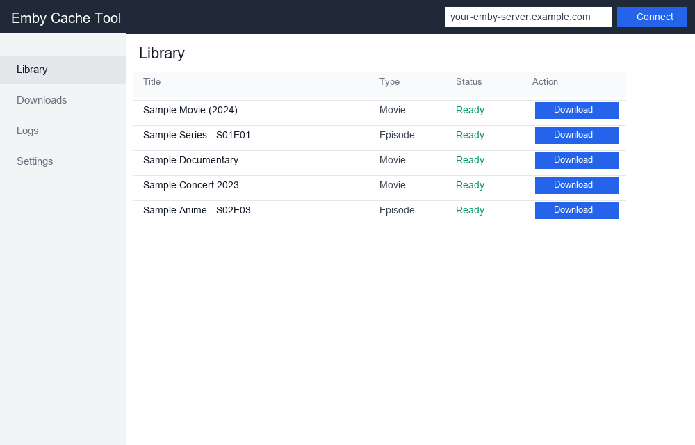
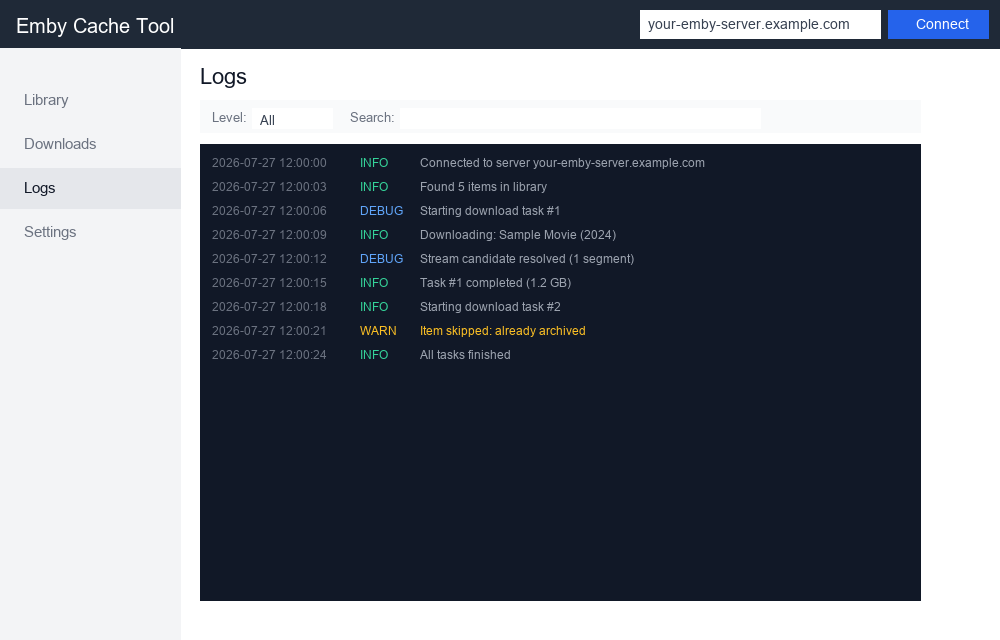

# emby-archiver

> A Python tool to archive Emby videos offline for Windows, Linux, Termux — with CLI, GUI and Web interfaces.
>
> 把 Emby 资源离线归档到本地的 Python 工具 —— 支持 Windows、Linux、Termux，提供 CLI、GUI 和 Web 三种入口。

---

## ⚠️ Disclaimer / 免责声明

> **仅限个人合法使用（For personal, legitimate use only）。**
>
> **emby-archiver 是一个技术中立的工具。** 与所有通用软件一样，它本身没有立场——**技术无罪，关键在于你怎么用**。
>
> 使用者须自行确认并承担以下责任：
> - 对你下载、归档的内容拥有合法权利（例如：你本人拥有该媒体，或内容位于你运营/获授权使用的服务器上）。
> - 遵守所在国家/地区的法律法规，以及所连接服务器的服务条款（ToS）。
>
> 本项目按 **「现状」(as is)** 提供，不附带任何明示或暗示的担保。作者**不鼓励、不纵容、亦不协助**任何侵犯版权、未经授权的再分发，或违反适用法律与第三方条款的行为。如因不当使用产生的任何后果，均由使用者自行承担。

> **For personal, legitimate use only.**
>
> **emby-archiver is a technologically neutral tool.** Like any general-purpose software, it takes no side — *the technology is innocent; what matters is how you use it*.
>
> You are solely responsible for ensuring and abiding by:
> - Having the legal right to archive the content you download (e.g. media you own, or content hosted on a server you operate or are authorized to use).
> - The laws and regulations of your jurisdiction, as well as the terms of service (ToS) of any server you connect to.
>
> This project is provided **"as is"**, without warranty of any kind. The authors do **not** encourage, condone, or assist copyright infringement, unauthorized redistribution, or any misuse that violates applicable law or third-party terms. Any consequences arising from misuse are solely the user's responsibility.

---

## Description / 项目描述

### English

**emby-archiver** is a lightweight Python downloader that logs into your Emby server and saves the media you can access to local storage for offline viewing. It is **not** a media player, not a streaming client, and not a "watch-while-downloading" buffer — it is purely an offline archiving tool.

Three entry points make it run anywhere:
- **CLI** — for terminal power users and scripting
- **GUI** (Tkinter) — for a familiar desktop experience
- **Web** (Starlette + uvicorn) — for headless boxes, remote access, phone or Termux browsers

Default `auto` mode picks the right one: GUI when a desktop is available, Web when not.

Key design choices:
- Multi-threaded segmented downloading with automatic single-thread fallback when the server doesn't support `Range`
- `.part`-based pause/resume so downloads survive network flake
- SQLite-backed record tracking so completed items are never re-downloaded
- Falls back to the playable stream (the same source the built-in player uses) when no download endpoint is available
- Optional experimental multipart probing for servers with unusual stream setups

### 中文

**emby-archiver** 是一个轻量级 Python 下载器，登录你的 Emby 服务器，把能访问的媒体资源离线保存到本地观看。它**不是**播放器、不是流媒体客户端、也不是"边下边播"的缓冲工具——它纯粹是一个离线归档工具。

三条入口让它随处可用：
- **CLI** — 终端重度玩家和脚本调用
- **GUI**（Tkinter）— 熟悉的桌面软件体验
- **Web**（Starlette + uvicorn）— 无图形环境、远程访问、手机或 Termux 浏览器

默认 `auto` 模式自动选择：有桌面走 GUI，没桌面走 Web。

核心设计：
- 多线程分段下载，服务端不支持 `Range` 时自动回退单线程
- 新分段任务预分配单个 `.part`，各区间直接写入，无需最终合并第二份完整文件
- 基于 `.part` + 原子进度元数据的暂停/续传，网络抖动后还能接着下
- Web 任务队列与可配置 worker 并发，整季条目可并行下载
- SSE 实时状态推送，断线时自动重连并启用低频轮询兜底
- SQLite 记录追踪，已完成项永不重复下载
- 服务端未开放下载入口时，回退到可播放流（与内置播放器同源）
- 可选的实验性分段探测，适配特殊服务端

---

## About emby-archiver / 关于

### English

If you run or are authorized to use an Emby server and want to archive the media you have the right to access — whether on a laptop, a small NAS box, or a phone running Termux — this tool is for you.

It was born from a few real, legitimate needs:

- Your own Emby server has great content but spotty internet; download once, watch anywhere offline
- You want a downloader on a headless VPS/NAS/Termux box with no GUI
- Emby's web player doesn't support every codec; offline archiving is more reliable
- On a server you operate or are authorized to archive, the tool can use the same playable stream the built-in player uses, so you can keep an offline copy of your own library

Most existing Emby clients focus on playback. There was a gap for a **pure offline archiving tool**. emby-archiver fills that gap.

### 中文

如果你运营或获授权使用一个 Emby 服务器，想把有权访问的媒体资源归档保存——无论是笔记本、NAS 小主机、还是跑着 Termux 的手机——这就是为你做的工具。

它来自这些真实且正当的需求：

- 自己的 Emby 服务器资源不错，但网络不稳定，想下载一次随时离线看
- 想在无图形环境的服务器 / NAS / Termux 上也能跑下载工具
- Emby Web 播放器不支持所有编码，离线转存更靠谱
- 在你运营或获授权归档的服务器上，工具可使用与内置播放器同源的播放流，便于你为自己的媒体库保留离线副本

现有 Emby 客户端大多偏播放，**纯粹的离线归档工具**是空白。emby-archiver 就是来填这个空白的。

---

## 预览

> 以下截图为占位示例数据（`your-emby-server.example.com` / `Sample ...`），仅展示界面布局，不包含真实服务器地址或媒体内容。

### Web UI 概览



### 日志面板



支持多历史日志文件切换、级别过滤、关键词搜索、自动滚动、加载更多。

---

## 当前能力

### 三条入口

| 入口 | 说明 | 启动方式 |
|------|------|----------|
| CLI | 纯终端操作 | `python app.py --mode cli` |
| Tkinter GUI | 桌面图形界面 | `python app.py --mode gui` 或 `python gui.py` |
| Web | 浏览器访问，支持手机/Termux | `python app.py --mode web` |

默认 `auto` 模式：有图形环境走 Tkinter，没有自动回退 Web。

### 核心功能

- 用户名 + 密码登录 Emby
- 兼容 `access_token` 或 `api_key` 方式
- 列出媒体库、搜索电影 / 剧集 / 季 / 集
- 下载单个电影，或展开整季 / 整部剧集逐集下载
- 支持 `.part` 临时文件断点续传
- 用 SQLite 记录缓存状态
- 优先走多线程分段下载，不支持 `Range` 时自动回退单线程
- 段级网络重试（指数退避）、完成尺寸精确校验、下载前磁盘空间预检
- ETag/If-Range 源同一性校验：续传时源变更（即使尺寸相同）自动从头重下，杜绝拼接损坏
- 可配置全局下载限速（`rate_limit_kbps`，令牌桶，单/多线程共享带宽上限）
- 暂停即断连：暂停时释放服务器连接，恢复后从断点重开 Range
- 多版本媒体源自动择优（选最高质量源）
- 外挂字幕随行下载：主文件完成后保存 Emby 外挂文本字幕为 `<视频名>.<语言>.srt`（`download_subtitles`，默认开启，失败不影响主文件）
- 入队判重：历史已完成的条目不再重复入队，入队响应显式报告跳过清单（`force_restart` 可强制重下）
- 磁盘空间护栏：某任务因磁盘不足失败时自动取消剩余排队任务并保留断点，避免队列逐个空转
- 通知钩子：下载完成/失败/取消触发用户自定义脚本（`notify_scripts`，`EMBYTOOL_*` 环境变量协议）
- 启动时自动回收上次崩溃残留的中断记录，可一键继续
- 可选开启实验性分段探测
- 支持为认证和下载链路配置 HTTP/HTTPS 代理

### Web 特有功能

- 访问令牌鉴权 + Host 白名单 + CSRF 防护（详见「Web 安全与鉴权」）
- 搜索资源、发起下载、通过 SSE 查看实时状态（速度/ETA/百分比/进度条）
- 任务队列与可配置 worker 并发（1-8），整季展开后可并行下载；入队时自动跳过已缓存条目并在响应中报告
- 队列终态历史有界保留（`job_history_limit`，默认 200），长运行内存不膨胀
- 暂停 / 继续 / 取消当前队列中的下载（取消时可选删除/保留临时文件）
- 设置默认下载目录（可持久化到 config.json）
- 调节单文件分段数（1-32）及任务 worker 数（1-8）
- 下载记录管理（继续未完成、删除已完成/未完成）；删除后自动清理影片空目录
- 完整日志系统：多历史文件切换、级别过滤、关键词搜索、行号、自动滚动
- 摘要栏显示代理配置、experimental_force_multipart 状态

---

## 快速开始

### 1. 准备配置

```bash
cp config.example.json config.json
# 编辑 config.json 填入你的 Emby 地址和账号信息
```

### 2. 安装依赖

需要 **Python ≥ 3.10**。

```bash
pip install -r requirements.txt
# 或以包方式安装（提供 emby-archiver 命令）
pip install .
```

### 3. 启动

```bash
# 默认 auto 模式（有 GUI 走 Tkinter，没有走 Web）
python app.py

# 强制 Web 模式
python app.py --mode web --host 127.0.0.1 --port 8765

# 局域网/手机访问（默认仅监听本机；绑定 0.0.0.0 前请先阅读下方「Web 安全与鉴权」）
python app.py --mode web --host 0.0.0.0 --port 8765
```

启动 Web 模式后，控制台会打印一条**带访问令牌**的链接，例如：

```
http://127.0.0.1:8765/?token=<随机令牌>
```

请用这条链接打开页面（首次访问会种下 HttpOnly Cookie，之后无需再带令牌）。令牌持久化在 `store/web_token.txt`，重启不变。详见下方「Web 安全与鉴权」。

---

## Web 安全与鉴权

Web 模式默认**仅监听 `127.0.0.1`**，并自 v0.2 起启用访问令牌鉴权，防止局域网/公网未授权操作你的下载与 Emby 凭据：

- **访问令牌**：启动时自动生成随机令牌，持久化于 `store/web_token.txt`（已 gitignore），重启保持不变。控制台打印带 `?token=` 的链接；首次访问种下 `HttpOnly` + `SameSite=Strict` Cookie，之后自动携带。
- **API 鉴权**：所有 `/api/*` 请求必须携带有效 Cookie 或 `X-Auth-Token` 请求头，否则返回 `401`。
- **Host 白名单**：仅允许 `localhost` / `127.0.0.1` / `::1` 及绑定地址访问，抵御 DNS rebinding；跨站 `Origin` 的状态变更请求被拒绝（CSRF 纵深防御）。
- **远程/手机访问**：如需绑定 `0.0.0.0`，请在 `config.json` 的 `web_allowed_hosts` 中显式加入你通过其访问的主机名/IP（例如 NAS 的局域网域名），否则会被 Host 白名单拦截。仍建议优先用反向代理 + TLS，或 SSH 隧道，而非直接暴露公网。

> 升级提示：旧版本 Web 无鉴权。升级后请用控制台打印的带令牌链接访问；直接访问 `http://host:port/` 会看到「需要访问令牌」页面。

---

## 配置说明

```json
{
  "server_url": "https://your-emby-server.example.com",
  "username": "your_username",
  "password": "your_password",
  "api_key": "",
  "access_token": "",
  "user_id": "",
  "download_dir": "downloads",
  "database_path": "store/cache.db",
  "device_name": "emby-cache-tool",
  "user_agent": "emby-cache-tool/0.1",
  "timeout": 30,
  "chunk_size": 1048576,
  "segments": 4,
  "download_workers": 1,
  "experimental_force_multipart": false,
  "proxy": "",
  "proxy_http": "",
  "proxy_https": "",
  "log_dir": "logs",
  "log_level": "INFO",
  "stream_segments": 2,
  "retry_attempts": 3,
  "retry_backoff_base": 0.5,
  "retry_backoff_max": 8.0,
  "slow_threshold_kbps": 50.0,
  "slow_window_seconds": 30.0,
  "rate_limit_kbps": 0,
  "job_history_limit": 200,
  "flush_interval_seconds": 0.0,
  "download_subtitles": true,
  "notify_scripts": [],
  "web_allowed_hosts": []
}
```

### 配置项详解

| 配置项 | 说明 |
|--------|------|
| `server_url` | Emby 服务器地址 |
| `username` / `password` | 登录账号（优先级最高） |
| `access_token` | 备选认证方式 |
| `api_key` | 备选认证方式，建议同时填 `user_id` |
| `download_dir` | 默认下载目录，相对路径或绝对路径均可 |
| `database_path` | SQLite 数据库路径 |
| `segments` | 单文件分段并发数（1-32），仅服务端支持 Range 时生效 |
| `download_workers` | Web 下载任务 worker 数（1-8），默认 1；整季下载建议按服务器与磁盘能力调整为 2-4 |
| `experimental_force_multipart` | 是否开启实验性分段探测 |
| `proxy` | 同时作用于 HTTP/HTTPS 的代理 |
| `proxy_http` / `proxy_https` | 分别配置 HTTP/HTTPS 代理 |
| `log_dir` | 日志目录，默认 `logs/` |
| `log_level` | 日志级别：`DEBUG` / `INFO` / `WARNING` / `ERROR` |
| `stream_segments` | Videos/stream 候选允许的最大分段数，默认 2 |
| `retry_attempts` | 段级网络重试次数，默认 3 |
| `retry_backoff_base` / `retry_backoff_max` | 重试指数退避基数/上限（秒），默认 0.5 / 8.0 |
| `slow_threshold_kbps` / `slow_window_seconds` | 慢速诊断阈值（KB/s）与观测窗口（秒），默认 50 / 30 |
| `rate_limit_kbps` | 全局下载限速（KB/s），`0` 为不限速；单/多线程共享带宽上限 |
| `job_history_limit` | Web 队列保留的终态任务条数上限，默认 200；超出时清理最早的已完成/失败/取消任务及其批次计数与条目锁，活动任务与磁盘下载记录不受影响；`0` 为不清理 |
| `flush_interval_seconds` | 预分配分段下载的刷盘节流间隔（秒），默认 `0` 为每个数据块落盘一次（现行为）；大于 0 时按秒批量刷盘与更新断点元数据，暂停/取消/分段结束仍精确落盘，硬崩溃后至多重传该间隔内的带宽量 |
| `download_subtitles` | 下载完成后是否顺带保存 Emby 外挂文本字幕（同名 `.语言.srt` 存于视频旁），默认 `true`；字幕失败不影响主文件成败 |
| `notify_scripts` | 下载事件通知脚本路径列表，默认 `[]` 不启用；条目完成/失败/取消时以环境变量 `EMBYTOOL_EVENTTYPE`（completed/failed/cancelled）、`EMBYTOOL_ITEM_ID`、`EMBYTOOL_ITEM_NAME`、`EMBYTOOL_PATH`、`EMBYTOOL_ERROR`、`EMBYTOOL_BATCH_ID`、`EMBYTOOL_SKIPPED` 触发；脚本失败/超时不影响下载任务 |
| `web_allowed_hosts` | Web Host 白名单额外允许的主机名/IP 列表（远程访问时填写），默认 `[]` |

---

## 使用指南

### CLI 用法

```bash
# 登录测试
python app.py --mode cli login-test

# 列出媒体库
python app.py --mode cli libraries

# 搜索资源
python app.py --mode cli search "你的关键字"

# 下载指定 item
python app.py --mode cli download --item-id 123456

# 查看下载记录
python app.py --mode cli downloads

# 继续未完成的下载
python app.py --mode cli resume
```

### GUI 用法

```bash
python gui.py
```

GUI 支持：加载配置、测试登录、搜索资源、选择默认下载目录、双击下载、查看下载记录和日志、实时速度/ETA/进度百分比、暂停/继续/取消、播放已完成文件、删除文件和记录。

### Web 用法

```bash
python app.py --mode web --host 127.0.0.1 --port 8765
```

Web 支持：测试登录、搜索资源、发起下载、单次指定下载目录、忽略断点重新开始、任务队列与 worker 并发、SSE 实时进度（断线自动重连 + 低频轮询兜底）、暂停/继续/取消、设置默认下载目录、下载记录管理和完整日志系统。

---

## 下载说明

### 文件组织

- 电影按 `片名 (年份)/片名 (年份).扩展名` 保存
- 剧集按 `剧名/Season 01/S01E01 - 标题.扩展名` 保存

### 分段下载逻辑

1. 默认使用 `segments` 设置的单文件分段数
2. 服务端不支持 `Range` 时自动回退单线程
3. 新分段任务在 `.part` 上预分配总大小，各段用独立文件句柄写入自身区间；每批数据刷盘后再原子更新 `.part.meta.json`
4. `flush_interval_seconds > 0` 时按秒节流批量刷盘与元数据更新（暂停/取消/段尾仍精确落盘）；默认 `0` 保持每批刷盘。基准（8MB×4段）：0s≈21MB/s、0.5s≈93MB/s
5. 旧 `.seg` 断点继续走兼容合并路径，避免升级后丢失旧进度；只有这类旧任务保留一次性合并空间开销
6. 开启 `experimental_force_multipart` 后，会直接试探真实分段请求验证是否可分段的转存链路
7. `stream_segments` 控制 `Videos/stream` 候选允许的最大分段数，避免一上来用太高并发把流地址打崩
8. 没有分段元数据的旧单线程 `.part` 断点继续走单线程续传，避免把旧字节误当成新区间格式

### 断点续传

- 目标文件已存在且下载记录已完成 → 直接跳过；Web 入队时即识别并报告，不再走完整下载流程
- 已有 `.part` / `.part.meta.json` → 按对应格式自动续传；预分配文件大小不再被误当作已下载进度
- 勾选"忽略断点重新开始" → 删除现有断点和分段元数据并重新下载
- 取消下载时 → 可选择删除或保留 `.part`、进度元数据及旧 `.seg` 临时文件
- ETag 或分段计划变化时，新预分配断点会从头重下；没有验证器时不会跨候选复用无法确认来源的旧字节
- 开启节流（`flush_interval_seconds > 0`）时硬崩溃至多重传该间隔内的带宽量；正确性不变（元数据永不超前已落盘数据）

### 日志说明

- GUI / Web 日志会显示候选地址类型、标准 Range 探测结果、实验分段探测结果和最终决策
- 下载记录会保存本次任务最终使用的模式，例如：
  - `分段并发下载（4 段）`
  - `实验性分段下载（4 段）`
  - `单线程续传（保留已有 .part）`
  - `单线程回退（服务端不支持分段）`

---

## 技术栈

| 组件 | 技术 |
|------|------|
| CLI | Python 标准库 |
| GUI | Tkinter |
| Web | Starlette + uvicorn |
| 数据库 | SQLite |
| 下载 | requests + 自研分段引擎 |
| 日志 | Python logging |

---

## 已知限制

- 部分服务器如果限制 API，可能无法登录或无法下载
- 某些服务器只给短期播放链接，失败时建议改用 `access_token`
- 正在运行中的旧下载进程不会热更新，必须重启 GUI / Web / 脚本后新逻辑才会生效
- 当前暂停/继续是进程内控制；如果直接关掉 GUI 或 Web 服务，需要靠 `.part` + `resume` 恢复（启动时会自动把残留 `downloading` 记录对账为 `interrupted`）
- 暂停即断连：暂停时主动释放服务器连接，恢复后从断点重开 Range（单线程与分段均已支持）；分段暂停期间数据库状态仍显示 `downloading`
- Web 任务队列保存在进程内，重启后不会自动恢复排队任务；已写入磁盘的 `.part` / 元数据仍可从下载记录继续
- 预分配引擎按批次刷盘并原子更新进度元数据，以更多 I/O 换取崩溃恢复精度；当前未提供不同硬件上的性能基准
- 旧 `.seg` 断点仍需一次兼容合并，新分段任务不再创建 `.seg`，也不需要第二份完整目标文件用于最终合并
- HLS 分片合并仍未实现，部分特殊资源可能无法直接离线

---

## 项目结构

```
emby-archiver/
├── app.py              # 统一启动入口
├── app_service.py      # 统一业务层
├── webapp.py           # Web 应用（Starlette）
├── gui.py              # Tkinter GUI
├── main.py             # CLI 入口
├── downloader.py       # 下载核心
├── emby_client.py      # Emby API 封装
├── library.py          # SQLite 下载记录
├── config.py           # 配置读取
├── models.py           # 数据模型
├── logger.py           # 日志配置
├── config.json         # 配置文件（需自行创建）
├── config.example.json # 配置示例
├── requirements.txt    # 依赖声明
├── pyproject.toml      # 包元数据（Python>=3.10）
├── tests/              # 回归与冒烟测试（pytest）
├── docs/images/        # 截图
├── downloads/          # 默认下载目录
├── logs/               # 日志目录
└── store/              # SQLite 数据库目录
```

---

## 认证建议

优先级：
1. 直接用 `username` + `password`
2. 如果服务器不让密码登录，改用 `access_token`
3. 如果你拿到的是 `api_key`，最好同时填 `user_id`

安全建议：
- `config.json` 以明文保存凭据，请收紧文件权限（Linux/Termux：`chmod 600 config.json`），不要提交到版本库（已 gitignore）。
- 优先使用 `api_key` / `access_token` 而非长期密码；下载记录与接口返回中的 URL 凭据会被自动剥离。
- 远程使用 Web 时务必保留令牌鉴权，并优先通过 TLS 反向代理或 SSH 隧道访问。

---

## 测试

```bash
pip install pytest httpx
python -m pytest tests -q
```

覆盖下载核心（路径安全/续传校验/段级重试/磁盘预检/进度节流）、存储与服务层（凭据剥离/WAL/启动对账/批量容错）、Web 安全（鉴权/Host/CSRF/XSS/脱敏）以及真实 uvicorn 全链路冒烟。
